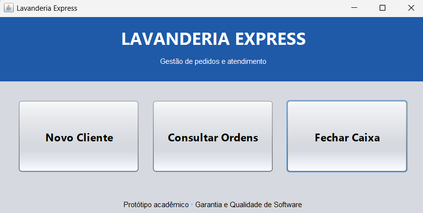
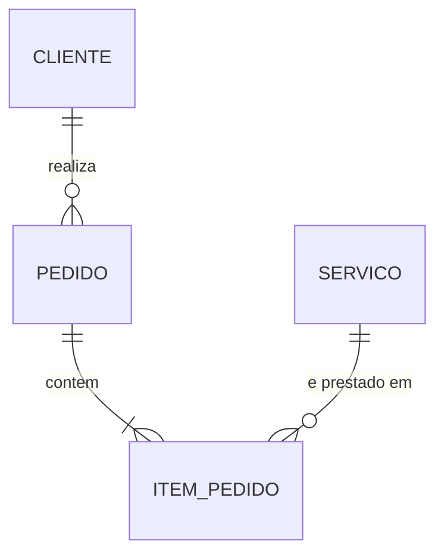

# Lavanderia Express: Gestão e Automação

Projeto acadêmico de conclusão de semestre, com foco em **Garantia e Qualidade de Software**. O sistema automatiza pedidos, controle de status de lavagem e fechamento de caixa para pequenas lavanderias locais.

> Não é um sistema para uso real. O objetivo é demonstrar boas práticas de qualidade (requisitos, TDD, BDD e análise estática) em um protótipo funcional integrado ao MySQL.

**Público-alvo:** balconistas, gestores operacionais e clientes finais de lavanderias rápidas.

## Funcionalidades

| ID | Requisito |
|---|---|
| RF01 | Cadastro rápido de novos clientes |
| RF02 | Registro de ordens de serviço de lavagem |
| RF03 | Consulta de status em tempo real |
| RNF01 | Resposta de tela inferior a 2 segundos |
| RNF02 | Cobertura de testes superior a 80% |
| RNF03 | Banco relacional normalizado |

Status do pedido: `PENDENTE → LAVANDO → PRONTO → ENTREGUE`

## Protótipo de telas

Telas em Java Swing, criadas com o GUI Builder do Apache NetBeans 31.



O painel principal oferece **Novo Cliente**, **Consultar Ordens** e **Fechar Caixa**.

## Modelo de dados



Detalhes das tabelas e colunas em `database/`.

## Tecnologias

Java 25 · Maven · Swing · MySQL + JDBC · JUnit (TDD) · Cucumber (BDD) · EclEmma · SonarQube · PMD

## Como rodar

**Pré-requisitos:** JDK 25, MySQL Server + Workbench, Apache NetBeans 31.

1. No MySQL Workbench, execute em ordem os scripts da pasta `database/`.
2. Copie `src/main/resources/db.properties.example` para `db.properties` e informe usuário e senha do seu MySQL. Esse arquivo não é versionado.
3. Abra o projeto no NetBeans e execute.

## Estrutura do repositório

```
├── database/    # scripts SQL
├── docs/        # requisitos, plano de testes e imagens
├── src/main/    # código Java (model, dao, view, util)
├── src/test/    # testes JUnit e cenários Cucumber (.feature)
└── pom.xml
```

## Como contribuir

1. Crie uma branch por tarefa: `git checkout -b feature/nome-da-tarefa`
2. Faça commits pequenos e descritivos (ex.: `feat: adiciona ClienteDAO`)
3. Abra um Pull Request e peça revisão de outro integrante antes de mesclar na `main`

Nunca versione senhas.

## Equipe

Integrantes e Responsabilidades:
Beatriz dos Anjos - Banco de Dados
Dhara Harumi - Controle de testes TDD e BDD
Gustavo Telles - Java e telas
Nícolas Ramos - Testes e qualidade

**Orientador(a):** Gratuliano · **Instituição:** Universidade São Judas Tadeu · **Ano:** 2026
